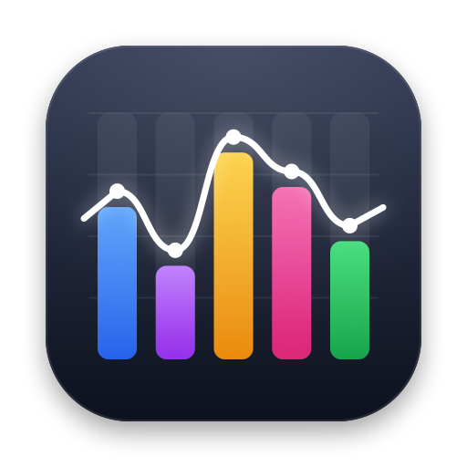
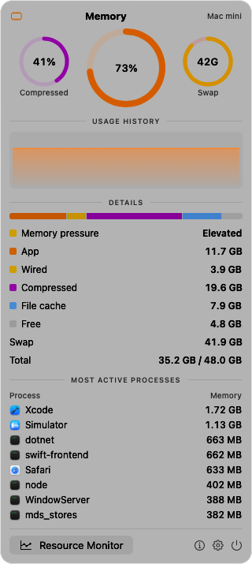
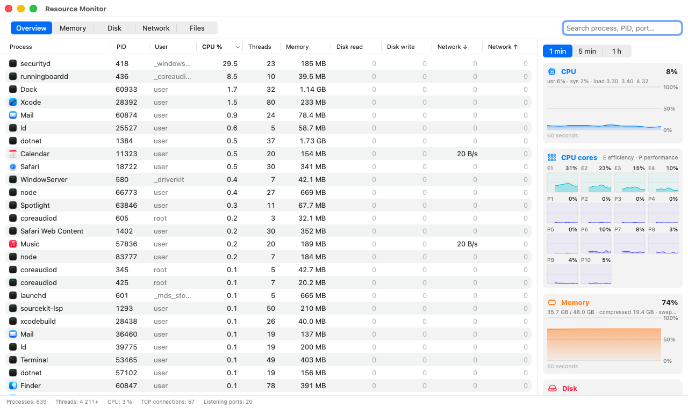
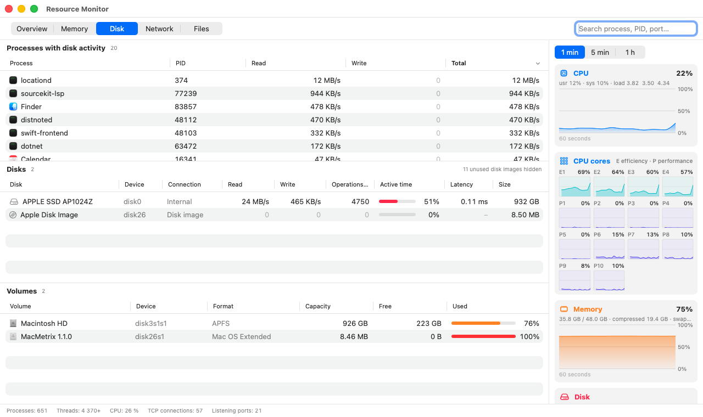

<p align="center">
  
</p>

<h1 align="center">MacMetrix</h1>

<p align="center">Your Macs' performance at a glance.</p>

MacMetrix shows the load of the **CPU, GPU, memory, disk, network and battery** in the menu bar,
in windows and in desktop widgets. The app is available in English and Czech; it follows the
system language (or the per-app language in *System Settings → General → Language & Region*).

<p align="center">
  
</p>

<table align="center">
  <tr>
    <td valign="top"></td>
    <td valign="top"></td>
    <td valign="top"></td>
  </tr>
</table>

## Features

- **Separate menu bar indicators** – CPU, GPU, RAM, Disk, Network and Battery each have their own
  fixed-width item, so they don't jump around as values change. Styles: *Two lines*, *Icon*,
  *Text* or *Bar*.
- **Sparkline** behind each indicator (optional) – the last 40 samples in the metric's color.
- **A window for each metric** when you click its icon: gauges, history, details and the most
  active processes. CPU includes the chip temperature, Disk the SSD temperature.
- **Resource Monitor** – like the one in Windows: every process with CPU, threads, memory, disk
  and network (sortable columns, search).
  - *Memory* tab: the composition of physical memory (app, wired, compressed, cached, free),
    memory pressure, and per process the real usage (footprint, as in Activity Monitor), its peak
    and pages read in from disk.
  - *Disk* tab: processes with disk activity, physical disks (read, write, operations per second,
    active time, latency) and volumes with used space; the volume menu shows who is using it.
  - *Network* tab: traffic per process, TCP connections and listening ports.
  - *Files* tab: open files and folders of the selected processes, or a search by path – for
    example, which process prevents a disk from being ejected.
  - Processes selected in *Overview* or *Memory* filter the *Disk*, *Network* and *Files* tabs.
    The context menu can quit or force quit a process or reveal it in Finder.
  - On the right, graphs for 1 minute, 5 minutes or an hour: CPU, **the history of every core**
    (efficiency E and performance P cores separately), memory, disk, network, battery and GPU.
    With one process selected, graphs of its CPU, memory, disk and network over the last
    5 minutes appear above them.
  - Optionally (*Settings → System process details*), a helper service with administrator
    privileges adds threads, memory, disk and open files for system and other users' processes.
- **Disk cleanup** – a wizard finds DerivedData, device support files, unavailable simulators,
  SPM/CocoaPods/NuGet/npm/Homebrew/Gradle caches, bin/obj and .build folders in projects, old
  temporary files and logs. It shows the sizes first and lets you pick categories; files can be
  deleted permanently or moved to the Trash.
- **Battery** (MacBook only) – charge, state and time remaining, system power draw, health,
  cycle count and battery temperature. On Macs without a battery the indicator is hidden.
- **Desktop widgets** (small / medium / large) with the history of the last hour.
- **Light and dark appearance** of the windows – following the system (default) or set in Settings.
- **Launch at login**, an About window, Settings in a separate window.

## Screenshots

**Resource Monitor** – all processes, graphs of the CPU, every core, memory, disk and network.



**Resource Monitor – Disk** – processes with disk activity, physical disks and volumes.



<table>
  <tr>
    <th>Disk window</th>
    <th>Disk cleanup</th>
    <th>Settings</th>
  </tr>
  <tr>
    <td valign="top"></td>
    <td valign="top"></td>
    <td valign="top"></td>
  </tr>
</table>

## Requirements

- macOS 14 Sonoma or later. Temperatures only on Apple Silicon Macs.
- To build: Xcode 16+ and [XcodeGen](https://github.com/yonaskolb/XcodeGen) (`brew install xcodegen`).

## Installing from the DMG (for users)

1. Download `MacMetrix-<version>.dmg` from the
   [Releases](https://github.com/kolarcik/MacMetrix/releases) page.
2. Open the DMG and drag **MacMetrix** to the **Applications** folder (replace the old version).
3. Launch MacMetrix from the Applications folder. The indicators appear in the menu bar.

The official DMG is signed with a Developer ID certificate and notarized by Apple, so it opens
without warnings. It contains a universal app for both Apple Silicon and Intel Macs.

On first launch MacMetrix registers itself as a login item – macOS shows a notification.
You can turn this off in the app's Settings or in *System Settings → General → Login Items*.

## Installing from a ZIP (remote Macs)

For installing on remote Macs over `scp` / SSH there is a ZIP with an install script:

1. Build the package with `./scripts/release.sh` (see below) and copy `dist/MacMetrix.zip`
   and `dist/install.sh` to the machine.
2. Run it **as the user who is logged in to the Mac's GUI** (for example via Screen Sharing):
   ```bash
   ./install.sh MacMetrix.zip
   ```
   The script installs the app to the Applications folder, quits the old version and its
   widget, and launches the new one.
3. For the app to run right after a restart, the Mac needs **automatic login** turned on
   (*System Settings → Users & Groups → Automatically log in as*) – login items only start
   after a user logs in.

## Usage

- **Clicking an indicator** in the menu bar opens the metric's window; an open window of
  another metric closes.
- The bottom bar of the window has the **Resource Monitor**, **About**, **Settings** and
  **Quit** buttons.
- **Settings:** window appearance (system, light, dark), launch at login, sampling interval,
  widget refresh interval, which indicators to show, their style and sparkline, system process
  details for the Resource Monitor.
- **⌘ + drag** reorders the indicators; dragging one out of the menu bar removes it. When none
  is selected, only the app icon is shown.
- **Resource Monitor** opens with the *Resource Monitor* button in the window's bottom bar.
- **Disk cleanup** opens from the Disk window with *Free up disk space…*
- **Widget:** right-click the desktop → *Edit Widgets* → MacMetrix.

### What is measured

| Metric | Source | Notes |
|---|---|---|
| CPU | `host_processor_info`, IOHID temperature sensors | total, user/system, per core, load average; temperature (average / max of `PMU tdie*`, Apple Silicon only) |
| GPU | IOKit `IOAccelerator → PerformanceStatistics` | "Device Utilization %" + GPU memory in use |
| RAM | `host_statistics64` | "Memory Used" as in Activity Monitor (app + wired + compressed), swap |
| Disk | `/` resource values, IOKit `IOBlockStorageDriver` | used space of the system volume + read/write B/s; SSD temperature |
| Battery | IOKit `AppleSmartBattery` | charge, charging / adapter, time remaining, health (full / design capacity), cycles, temperature, battery power (voltage × current), system power draw (Apple Silicon telemetry) |
| Network | `sysctl IFMIB_IFDATA` (64-bit counters) | **IN ↓** (blue) / **OUT ↑** (red) separately; only `en*` interfaces are counted, so loopback, VPN and VM bridges (e.g. tart) aren't counted twice. When the system reports no inbound bytes on `en*` (happens with VPNs / network extensions), IN is taken from the VPN tunnels and the legend says "(VPN)". |

The network gauge is relative to 1 Gbit/s (125 MB/s). Processes are read with `ps`, network
processes with `nettop`, disk processes with `proc_pid_rusage` (only the logged-in user's
processes). The Resource Monitor takes connections and ports from `nettop` (it sees system
processes too) and physical disks from IOKit `IOBlockStorageDriver` statistics; thread counts,
disk activity, memory footprint (`proc_pid_rusage`) and open files (`proc_pidinfo` /
`proc_pidfdinfo`) are only available for the logged-in user's processes, others show "–"
unless the helper service is on. It only samples while its window is open.

### System process details (helper service)

Without administrator privileges macOS doesn't reveal the threads, memory, disk activity or open
files of system and other users' processes. By default everything is off and nothing is
registered. The *Settings → System process details* switch registers the `MacMetrixHelper`
helper service (a launchd daemon running as root) with `SMAppService.daemon`. macOS only lets it
run after you approve it in *System Settings → General → Login Items*.

- The service **only reads** (`proc_pid_rusage`, `proc_pidinfo`, `proc_pidfdinfo`) – it has no
  operation that changes or deletes anything or sends signals to processes.
- It only accepts connections from the `tech.synot.MacMetrix` app signed by the same team
  (code signing check via `setCodeSigningRequirement`); the app checks the service's signature
  the same way.
- launchd starts it on demand and it quits by itself after two minutes without a request.
- Turning the switch off unregisters the service.

## Troubleshooting

**The widget shows old data**
At the set interval (10 s by default) the app writes data to the shared App Group container and
asks WidgetKit to reload. **macOS throttles widget reloads**, so the widget may not be up to the
second – it shows the time of the last sample. When the widget last reloaded is shown in
Settings. For live data use the metric windows and the Resource Monitor. When the app isn't
running, the widget samples values itself (without history).

After installing a new version, the old widget extension may still be running. This helps:

```bash
pkill -f MacMetrixWidget.appex
```

**An indicator disappeared from the menu bar**
When the menu bar runs out of space, macOS hides items. The indicator stays enabled in Settings
and comes back once there is room. If you removed all of them, the app icon is shown; turn
indicators on in Settings, or reopen MacMetrix from the Applications folder to restore them.

**The temperature isn't shown**
Temperatures are read from Apple Silicon temperature sensors. They aren't available on Intel Macs.

## Known limitations

- macOS limits how often widgets reload.
- Without the helper service, disk activity of processes is only known for the logged-in
  user's processes.
- Temperatures are read through a private system interface; their availability may change
  between macOS versions.

## Development

The project is a SwiftUI app with a WidgetKit extension and a helper tool, defined in
`project.yml` for XcodeGen.

```bash
git clone https://github.com/kolarcik/MacMetrix.git
cd MacMetrix
xcodegen generate
open MacMetrix.xcodeproj
```

It is signed with the **Developer ID Application** certificate of team `3ZN9TSG9S7`
(`DEVELOPMENT_TEAM` in `project.yml`). The App Group has the form `<TEAM>.tech.synot.MacMetrix`,
so no provisioning profile is needed.

UI texts are written in Czech in the code (the development language) and translated to English
in the String Catalog `Shared/Localizable.xcstrings`. Untranslated languages fall back to English
(`CFBundleDevelopmentRegion` is `en`), so the catalog also keeps a Czech value for every string –
give new strings both a Czech and an English value. Xcode adds new strings to the catalog when you
build; from the command line use (the setting works around the helper's embedded Info.plist):

```bash
xcodebuild -exportLocalizations -project MacMetrix.xcodeproj -localizationPath /tmp/loc \
  -exportLanguage en -exportLanguage cs CREATE_INFOPLIST_SECTION_IN_BINARY=NO
xcodebuild -importLocalizations -project MacMetrix.xcodeproj -localizationPath /tmp/loc/en.xcloc \
  CREATE_INFOPLIST_SECTION_IN_BINARY=NO
```

```
App/       menu bar app: indicators, metric windows, Resource Monitor,
           disk cleanup, settings, About, temperature sensors, processes
Helper/    helper service with administrator privileges (read-only) and process readers shared with the app
LaunchDaemons/  launchd plist of the helper service (copied to Contents/Library/LaunchDaemons)
Widget/    WidgetKit extension
Shared/    metric sampling, shared state, common SwiftUI components (gauges, charts), String Catalog
scripts/
├── make-dmg.sh    – installer DMG for distribution
├── release.sh     – ZIP for installing on remote Macs
├── install.sh     – installs the ZIP on a machine
└── make-icon.swift – app icon generator
project.yml        – project definition for XcodeGen
```

### Building the installer DMG

```bash
./scripts/make-dmg.sh
```

Creates `dist/MacMetrix-<version>.dmg` (version from `MARKETING_VERSION` in `project.yml`):
a universal Release build, Developer ID signature with hardened runtime, a DMG with an
Applications folder shortcut and a volume icon.

For an app downloaded from the internet to open without warnings, it has to be notarized by Apple:

1. Store the notarization credentials in the Keychain once
   (an app-specific password from [account.apple.com](https://account.apple.com)):
   ```bash
   xcrun notarytool store-credentials <profile> --apple-id <apple-id> --team-id 3ZN9TSG9S7
   ```
2. Build the DMG with notarization:
   ```bash
   NOTARY_PROFILE=<profile> ./scripts/make-dmg.sh
   ```

The script submits the DMG for notarization, staples the ticket and verifies it with Gatekeeper.

### Package for remote Macs

```bash
NOTARY_PROFILE=<profile> ./scripts/release.sh
```

Creates `dist/MacMetrix.zip` and `dist/install.sh` (see [Installing from a ZIP](#installing-from-a-zip-remote-macs)).

### Screenshots

The screenshots in `docs/screenshots` are taken in demo mode, which shows generic values instead
of the Mac's name, IP addresses and process names (the measured values stay real):

```bash
open /Applications/MacMetrix.app --args -demoMode YES -AppleLanguages "(en)"
```
