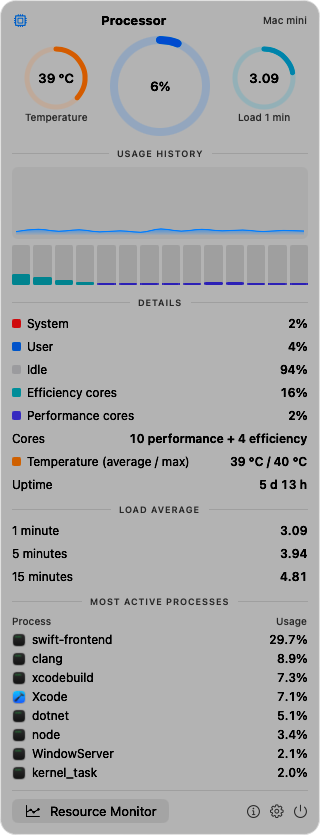
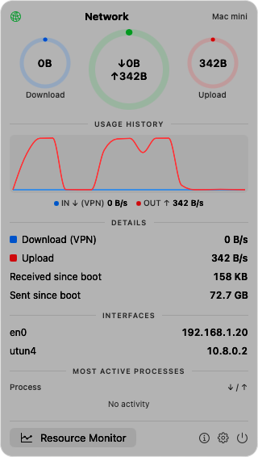
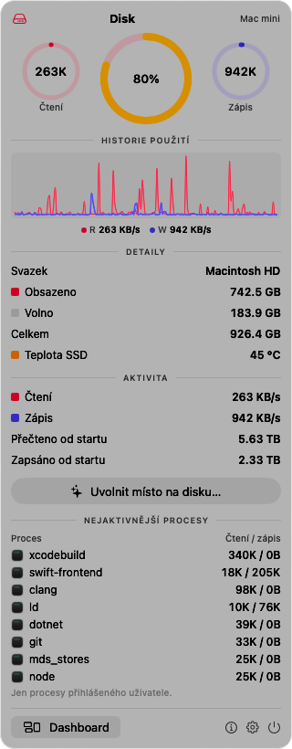
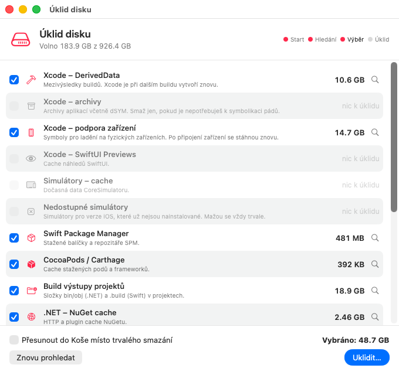
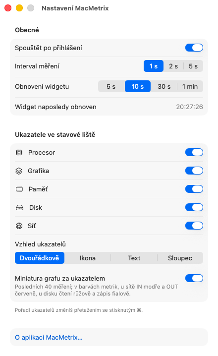

<p align="center">
  
</p>

<h1 align="center">MacMetrix</h1>

<p align="center">Výkon vašich Maců na první pohled.</p>

MacMetrix ukazuje ve stavové liště, v oknech a ve widgetech na ploše vytížení
**CPU, GPU, paměti, disku, sítě a baterie**.

<p align="center">
  
</p>

<table align="center">
  <tr>
    <td valign="top"></td>
    <td valign="top"></td>
    <td valign="top"></td>
  </tr>
</table>

## Funkce

- **Samostatné ukazatele ve stavové liště** – CPU, GPU, RAM, Disk, Síť a Baterie mají každý
  vlastní položku s pevnou šířkou, takže při změně hodnot neposkakují. Vzhled:
  *Dvouřádkově*, *Ikona*, *Text* nebo *Sloupec*.
- **Miniatura grafu** za každým ukazatelem (volitelně) – posledních 40 měření v barvě metriky.
- **Okno každé metriky** po kliknutí na její ikonu: ukazatele, historie, detaily
  a nejaktivnější procesy. CPU i s teplotou čipu, Disk s teplotou SSD.
- **Monitor prostředků** – jako ve Windows: všechny procesy s CPU, vlákny, pamětí, diskem a sítí
  (řazení podle sloupců, hledání) a záložka *Síť* s provozem procesů, TCP spojeními
  a naslouchajícími porty. Procesy vybrané v *Přehledu* filtrují záložku *Síť*.
  Z kontextové nabídky jde proces ukončit, vynutit jeho ukončení nebo ho zobrazit ve Finderu.
  Vpravo jsou grafy za 1 minutu, 5 minut nebo hodinu: CPU, **historie každého jádra**
  (efektivní E a výkonná P zvlášť), paměť, disk, síť a GPU.
- **Úklid disku** – průvodce najde DerivedData, podporu zařízení, nedostupné simulátory,
  cache SPM/CocoaPods/NuGet/npm/Homebrew/Gradle, bin/obj a .build v projektech, staré
  dočasné soubory a logy. Nejdřív ukáže velikosti a nechá vybrat kategorie; mazat jde
  trvale nebo do Koše.
- **Baterie** (jen na MacBooku) – nabití, stav a zbývající čas, příkon systému, kondice, cykly
  a teplota baterie. Na Macu bez baterie se ukazatel nezobrazuje.
- **Widgety na plochu** (malý / střední / velký) s historií za poslední hodinu.
- **Světlý a tmavý motiv** oken – podle systému (výchozí) nebo podle volby v Nastavení.
- **Spouštění po přihlášení**, okno O aplikaci, Nastavení v samostatném okně.

## Snímky obrazovky

<table>
  <tr>
    <th>Okno Disku</th>
    <th>Úklid disku</th>
    <th>Nastavení</th>
  </tr>
  <tr>
    <td valign="top"></td>
    <td valign="top"></td>
    <td valign="top"></td>
  </tr>
</table>

## Požadavky

- macOS 14 Sonoma nebo novější. Teploty jen na Macu s Apple Silicon.
- Pro sestavení Xcode 16+ a [XcodeGen](https://github.com/yonaskolb/XcodeGen) (`brew install xcodegen`).

## Instalace z DMG (pro uživatele)

1. Stáhněte `MacMetrix-<verze>.dmg` ze stránky
   [Releases](https://github.com/kolarcik/MacMetrix/releases).
2. Otevřete DMG a přetáhněte **MacMetrix** do složky **Aplikace** (starou verzi nahraďte).
3. Spusťte MacMetrix ze složky Aplikace. Ve stavové liště se objeví ukazatele.

Oficiální DMG je podepsané certifikátem Developer ID a notarizované u Apple,
takže se otevře bez varování. Obsahuje univerzální aplikaci pro Macy s Apple Silicon i Intel.

Při prvním spuštění se MacMetrix zaregistruje jako položka při přihlášení – macOS
zobrazí notifikaci. Vypnout to jde v Nastavení aplikace nebo v
*Nastavení systému → Obecné → Položky při přihlášení*.

## Instalace přes ZIP (vzdálené Macy)

Pro instalaci na vzdálené Macy přes `scp` / SSH je k dispozici ZIP s instalačním skriptem:

1. Sestavte balíček `./scripts/release.sh` (viz níže) a zkopírujte `dist/MacMetrix.zip`
   a `dist/install.sh` na stroj.
2. Spusťte **pod uživatelem, který je na Macu přihlášený v GUI** (třeba přes Sdílení obrazovky):
   ```bash
   ./install.sh MacMetrix.zip
   ```
   Skript aplikaci nainstaluje do složky Aplikace, ukončí starou verzi i její widget a spustí novou.
3. Aby aplikace běžela hned po restartu, musí mít Mac zapnuté
   **automatické přihlášení** (*Nastavení systému → Uživatelé a skupiny → Automaticky
   přihlásit*) – položka při přihlášení se spouští až po přihlášení uživatele.

## Ovládání

- **Klik na ukazatel** ve stavové liště otevře okno metriky; otevřené okno jiné metriky se zavře.
- Ve spodní liště okna jsou tlačítka **Monitor prostředků**, **O aplikaci**, **Nastavení** a **Ukončit**.
- **Nastavení:** motiv oken (podle systému, světlý, tmavý), spouštění po přihlášení, interval měření, interval obnovení widgetu,
  které ukazatele zobrazit, jejich vzhled a miniatura grafu.
- **⌘ + tažení** ukazatele přeskládá pořadí; vytažením ze stavové lišty se ukazatel odebere.
  Když není vybraný žádný, zobrazí se jen ikona aplikace.
- **Monitor prostředků** se otevře tlačítkem *Monitor prostředků* ve spodní liště okna.
- **Úklid disku** se otevře z okna Disku tlačítkem *Uvolnit místo na disku…*
- **Widget** přidáte pravým klikem na plochu → *Upravit widgety* → MacMetrix.

### Co se měří

| Metrika | Zdroj | Poznámka |
|---|---|---|
| CPU | `host_processor_info`, IOHID teplotní senzory | celkem, user/system, po jádrech, load average; teplota (průměr / max `PMU tdie*`, jen Apple Silicon) |
| GPU | IOKit `IOAccelerator → PerformanceStatistics` | „Device Utilization %“ + využitá paměť GPU |
| RAM | `host_statistics64` | „Použitá paměť“ jako v Monitoru aktivity (app + wired + komprimovaná), swap |
| Disk | `/` resource values, IOKit `IOBlockStorageDriver` | obsazenost systémového svazku + čtení/zápis B/s; teplota SSD |
| Baterie | IOKit `AppleSmartBattery` | nabití, nabíjení / adaptér, zbývající čas, kondice (plná kapacita / návrhová), cykly, teplota, výkon baterie (napětí × proud), příkon systému (telemetrie Apple Silicon) |
| Síť | `sysctl IFMIB_IFDATA` (64bit čítače) | zvlášť **IN ↓** (modře) / **OUT ↑** (červeně); počítají se jen rozhraní `en*`, takže loopback, VPN a bridge VM (např. tart) se nezapočítají dvakrát. Když systém na `en*` příchozí bajty nehlásí (stává se s VPN / síťovými rozšířeními), bere se IN z VPN tunelů a v legendě je „(VPN)“. |

Ukazatel sítě je vztažený k 1 Gbit/s (125 MB/s). Procesy se čtou přes `ps`, síťové
procesy přes `nettop`, diskové přes `proc_pid_rusage` (jen procesy přihlášeného uživatele).
Monitor prostředků bere spojení a porty z `nettop` (vidí i systémové procesy); počet vláken a disk
zná jen u procesů přihlášeného uživatele, u ostatních ukazuje „–“. Měří jen při otevřeném okně.

## Řešení potíží

**Widget ukazuje stará data**
Aplikace v nastaveném intervalu (výchozí 10 s) zapíše data do sdíleného App Group
kontejneru a požádá WidgetKit o obnovení. **macOS ale obnovování widgetů omezuje**,
takže widget nemusí být aktuální na sekundu – ukazuje čas posledního měření. Kdy se
widget naposledy obnovil, je vidět v Nastavení. Pro živá data slouží okna metrik
a Monitor prostředků. Když aplikace neběží, widget si změří hodnoty sám (bez historie).

Po instalaci nové verze může běžet stará widget extension. Pomůže:

```bash
pkill -f MacMetrixWidget.appex
```

**Ukazatel zmizel ze stavové lišty**
Když na liště není místo, macOS položky skrývá. V Nastavení zůstane ukazatel zapnutý
a po uvolnění místa se vrátí. Když jste odebrali všechny, zobrazí se ikona aplikace;
ukazatele zapnete v Nastavení, případně je obnoví nové otevření MacMetrix ze složky Aplikace.

**Teplota se nezobrazuje**
Teploty se čtou z teplotních senzorů Apple Silicon. Na Macu s Intelem nejsou k dispozici.

## Známá omezení

- macOS omezuje, jak často se widgety obnovují.
- Diskové procesy se zjišťují jen pro procesy přihlášeného uživatele.
- Teploty se čtou přes neveřejné systémové rozhraní; jejich dostupnost se může s verzemi macOS měnit.

## Vývoj

Projekt je SwiftUI aplikace s WidgetKit extension, definovaná v `project.yml` pro XcodeGen.

```bash
git clone https://github.com/kolarcik/MacMetrix.git
cd MacMetrix
xcodegen generate
open MacMetrix.xcodeproj
```

Podepisuje se certifikátem **Developer ID Application** týmu `3ZN9TSG9S7`
(`DEVELOPMENT_TEAM` v `project.yml`). App Group má tvar `<TEAM>.tech.synot.MacMetrix`,
takže nepotřebuje provisioning profil.

```
App/       aplikace ve stavové liště: ukazatele, okna metrik, Monitor prostředků,
           úklid disku, nastavení, O aplikaci, teplotní senzory, procesy
Widget/    WidgetKit extension
Shared/    měření metrik, sdílený stav, společné SwiftUI komponenty (ukazatele, grafy)
scripts/
├── make-dmg.sh    – instalační DMG pro distribuci
├── release.sh     – ZIP pro instalaci na vzdálené Macy
├── install.sh     – instalace ZIPu na stroji
└── make-icon.swift – generátor ikony aplikace
project.yml        – definice projektu pro XcodeGen
```

### Vytvoření instalačního DMG

```bash
./scripts/make-dmg.sh
```

Vytvoří `dist/MacMetrix-<verze>.dmg` (verze z `MARKETING_VERSION` v `project.yml`):
univerzální Release build, podpis Developer ID s hardened runtime, DMG se zástupcem
složky Aplikace a ikonou svazku.

Aby šla aplikace stažená z internetu otevřít bez varování, musí být notarizovaná u Apple:

1. Jednou uložte přihlašovací údaje pro notarizaci do Klíčenky
   (heslo pro aplikace z [account.apple.com](https://account.apple.com)):
   ```bash
   xcrun notarytool store-credentials <profil> --apple-id <apple-id> --team-id 3ZN9TSG9S7
   ```
2. Sestavte DMG s notarizací:
   ```bash
   NOTARY_PROFILE=<profil> ./scripts/make-dmg.sh
   ```

Skript DMG odešle k notarizaci, připojí k němu lístek a ověří ho Gatekeeperem.

### Balíček pro vzdálené Macy

```bash
NOTARY_PROFILE=<profil> ./scripts/release.sh
```

Vytvoří `dist/MacMetrix.zip` a `dist/install.sh` (viz [Instalace přes ZIP](#instalace-přes-zip-vzdálené-macy)).

### Snímky obrazovky

Snímky v `docs/screenshots` jsou pořízené v ukázkovém režimu, který místo názvu Macu,
IP adres a názvů procesů ukazuje obecné údaje (hodnoty měření zůstávají skutečné):

```bash
open /Applications/MacMetrix.app --args -demoMode YES
```
